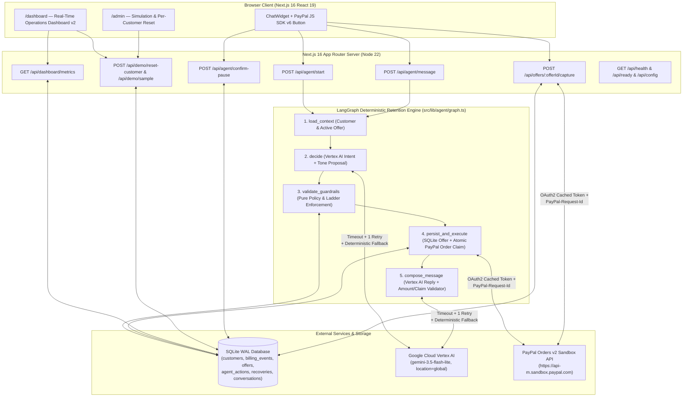
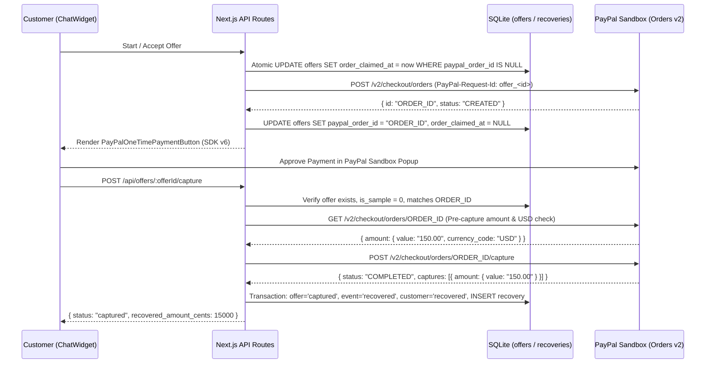

# ChurnRescue AI — System Architecture (`docs/ARCHITECTURE.md`)

## 1. High-Level System Architecture

---

## 2. LangGraph 5-Node Execution Pipeline (`src/lib/agent/graph.ts`)

Every customer turn (`POST /api/agent/start` or `POST /api/agent/message`) runs through a 5-node state graph:

1. **`load_context`:** Loads the customer's plan, `plan_price_cents`, `usage_percent`, and any active non-sample offer (`status IN ('pending', 'accepted') AND is_sample = 0`).
2. **`decide`:** Calls Vertex AI (`gemini-3.5-flash-lite`) with structured output (`intent` + `proposalSchema`).
   - `proposalSchema` deliberately excludes discount percentages and prices so the LLM can only classify intent (`negotiate`, `accept`, `decline`, `cancel`, `neutral`, `escalate`, `pause_request`, `question`) and suggest tone notes.
   - Wrapped in `callWithTimeoutAndRetry` (15s timeout + 1 retry). If Vertex AI fails, `inferFallbackIntent()` deterministically classifies the user's message and logs `outcome_code: "llm_fallback_used"`.
3. **`validate_guardrails`:** Pure deterministic policy engine (`validateProposal` in `src/lib/agent/guardrails.ts`):
   - Checks compliance/dispute keywords first (`detectEscalation()`).
   - Computes `ladderStep = nextLadderStep(previousLadder, intent)` (`0 -> 20%`, `1 -> 35%`, `2 -> 50%`).
   - Blocks `partial_credit` when `usage_percent >= 60%` (`PARTIAL_CREDIT_MAX_USAGE_EXCLUSIVE = 60`).
   - Escalates on pushback #4 (`previousLadder >= 2` + `intent === 'negotiate'`) or second cancel at high usage.
   - Preserves the active offer when `intent === 'question'` (`E2`) and marks the active offer `declined` when `intent === 'decline'` (`E3`).
4. **`persist_and_execute`:**
   - Supersedes prior open offers when creating a new offer or escalating.
   - Inserts the new `offers` row (`pending` or `accepted` on initial proactive offer) and calls `createOrderInternal(offerId)` to atomically claim and create a PayPal Order v2 when `amount_cents > 0`.
5. **`compose_message`:**
   - Generates natural-language reply via Vertex AI, sanitizes markdown/links (`sanitizeReply`), and validates every dollar figure in the reply with `checkMessageAmounts(lastMsg, required, allowed)` plus state-specific invariants (`question`, `decline`, `pause`, `escalate`).
   - If any invariant fails (or if the LLM timed out), replaces the reply with a deterministic, state-correct template and records `template_used: true` in `agent_actions.details_json`.

---

## 3. PayPal Checkout v6 + Orders v2 Sequence

