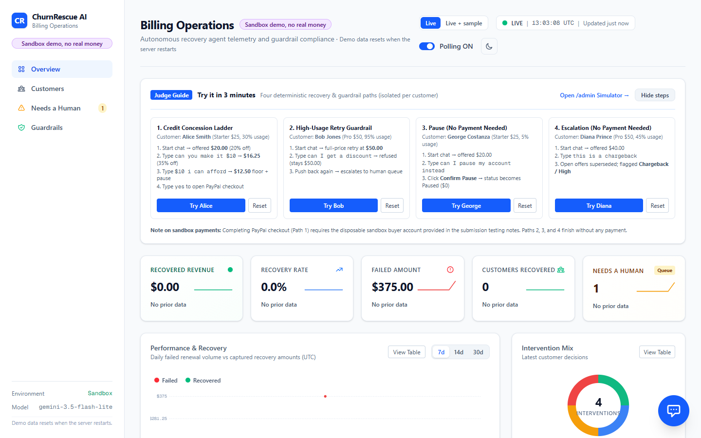
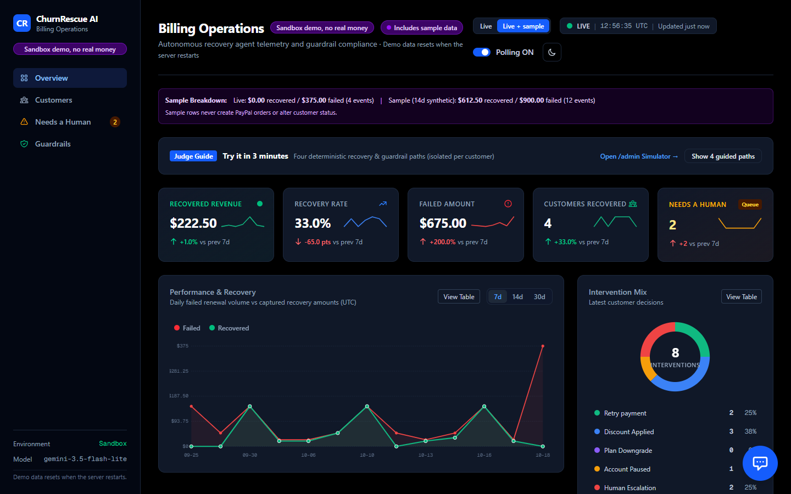
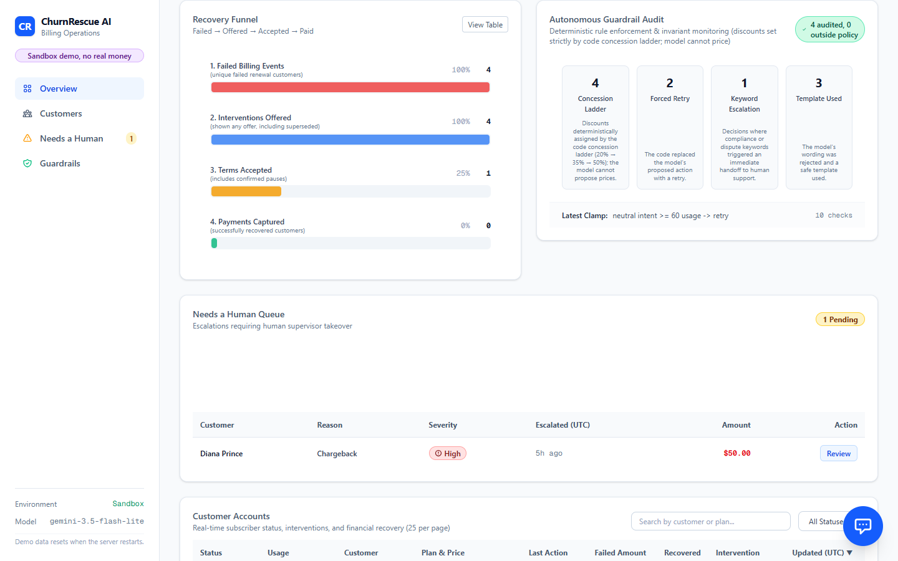
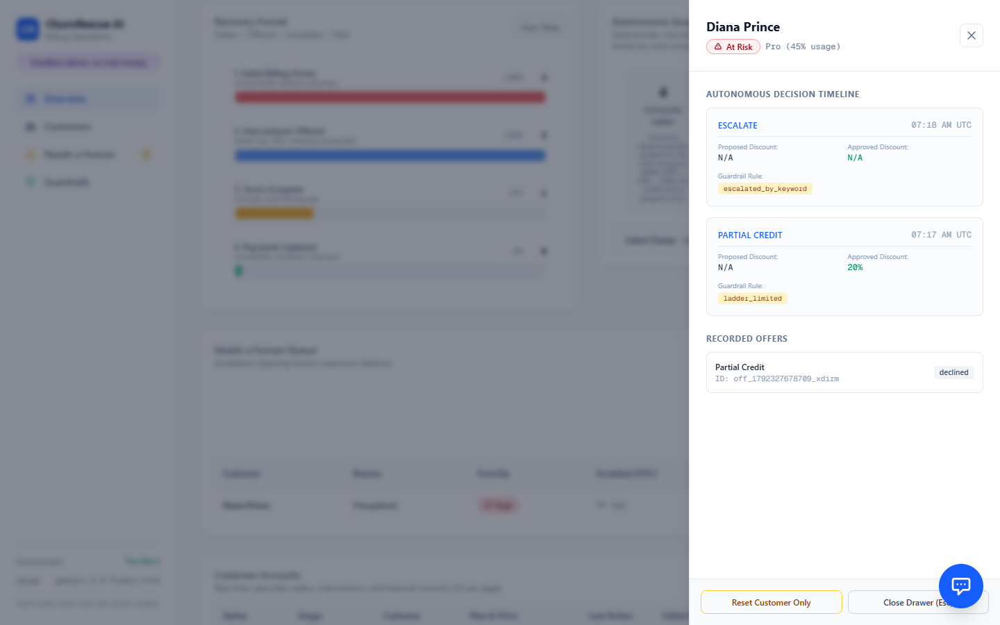
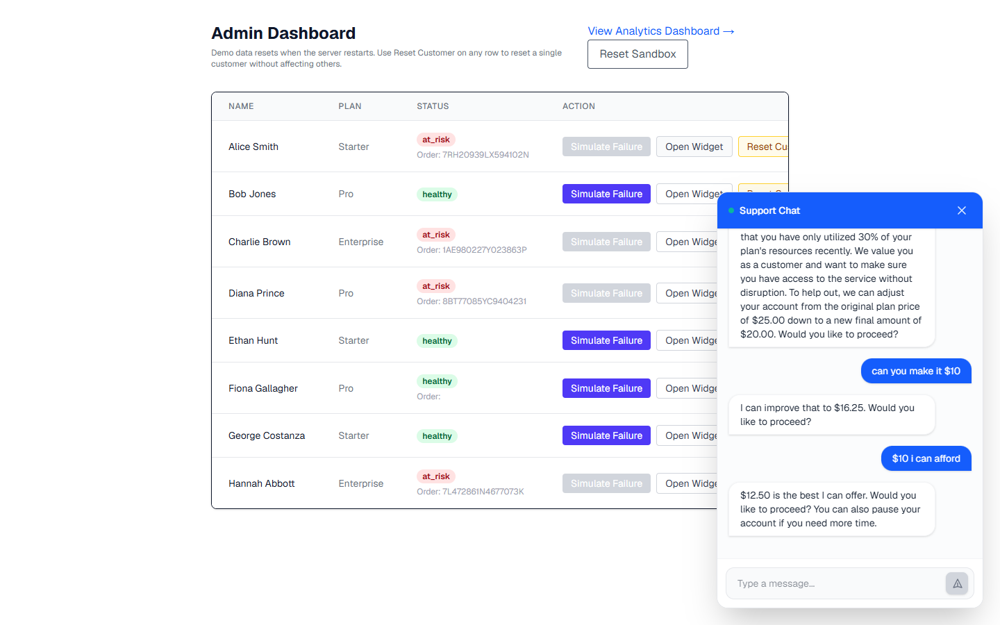
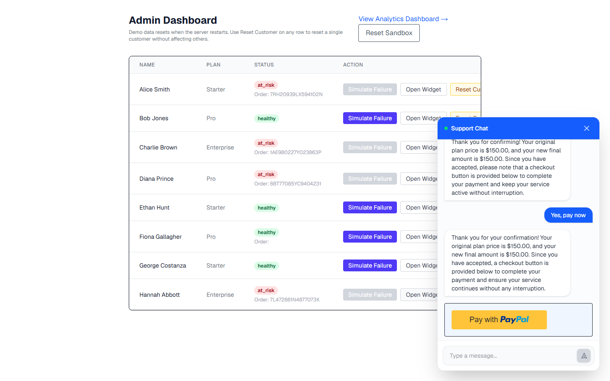
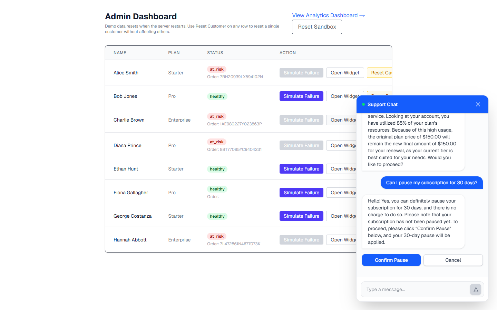
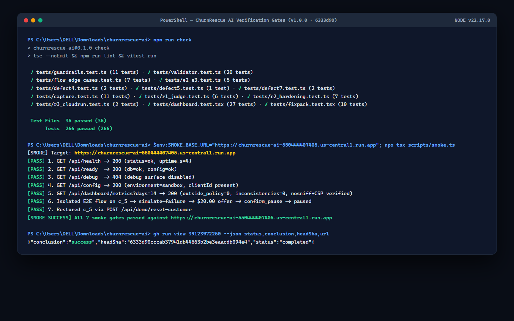

# ChurnRescue AI — Submission Screenshots (`docs/SCREENSHOTS.md`)

This gallery documents the 8 submission screenshots captured at `1440×900` / `1920×1080` showcasing ChurnRescue AI's autonomous recovery, deterministic guardrails, multi-turn concession ladder, PayPal Checkout v6 integration, and release verification gates.

All files are stored in [`docs/assets/screenshots/`](assets/screenshots/).

---

## Screenshot Gallery

### 1. Operations & Analytics Dashboard (`Light Mode · Live Data`)
Header with `"Sandbox demo, no real money"` badge, expanded **"Try it in 3 minutes"** bar (4 guided paths), and the 5 KPI cards (`$150.00` Recovered Revenue, `1` Customer Recovered, `Needs a Human`).

---

### 2. Operations & Telemetry Dashboard (`Dark Mode · Live + Sample History`)
Switched to **Live + sample**, showing the `"Includes sample data"` badge, live-vs-sample breakdown banner, 14-day **Failed vs Recovered by Day** timeline chart, **Intervention Mix** donut, and **Recovery Funnel** ($222.50 recovered revenue, 33.0% recovery rate, zero audit errors).

---

### 3. Autonomous Guardrail Audit & Needs a Human Queue
Autonomous Guardrail Audit panel (`Concession Ladder`, `Forced Retry`, `Keyword Escalation`, `Template Used`, `0 outside policy`) and **Needs a Human** queue showing **Diana Prince** (`Chargeback`, `High`, `$50.00`) immediately escalated upon dispute keywords.

---

### 4. Customer Decision Timeline Drawer
Slide-over **Customer Decision Timeline Drawer** showing chronological guardrail audit cards, intent classifications, outcome codes, and the per-customer isolated reset action.

---

### 5. Multi-Turn Concession Ladder & Hard Floor Clamp (`Alice Smith`)
Support Chat conversation demonstrating the deterministic concession ladder: `$20.00` (step 0, 20% off) $\to$ `$16.25` (step 1, 35% off) $\to$ `$12.50` (step 2 floor clamp, 50% max policy) with bright yellow PayPal Checkout button rendered upon terms acceptance.

---

### 6. High-Usage Guardrail & Full-Price Retry (`Hannah Abbott`)
High-usage account (85% utilization on Enterprise `$150.00/mo`) deterministically blocked from discounting and offered a full-price retry with the live **PayPal Checkout v6** button rendered.

---

### 7. Two-Step Explicit Pause Confirmation (`Charlie Brown · E1`)
Two-step explicit pause invariant: customer requests a 30-day pause, AI explains `"Please click Confirm Pause below to proceed. Your subscription has not been paused yet."`, rendering **Confirm Pause** and **Cancel** buttons without premature database state changes.

---

### 8. Release Verification & Smoke Gates Terminal Capture
Clean terminal capture showing passing typecheck, ESLint, Vitest test suite (`35 files, 266 tests passing`), and automated 7-gate Cloud Run HTTP smoke suite (`[SMOKE SUCCESS] All 7 smoke gates passed`).

